> [!NOTE]
> This is my fork of
> [Hieupham0012/Sofle-oled_wireless](https://github.com/Hieupham0012/Sofle-oled_wireless),
> the ZMK firmware config by CN Technology & Computer for their wireless Sofle
> keyboard with OLED displays. I've only added my own keymap
> (`config/sofle.keymap`, drawn below); everything else is the original.

# Chú ý: Với các bạn đã Fork từ trước. Vào 2 mục sofle.conf và build.yaml copy paste vào repositories cũ của mình để mở chức năng zmk studio

# Default keymap

